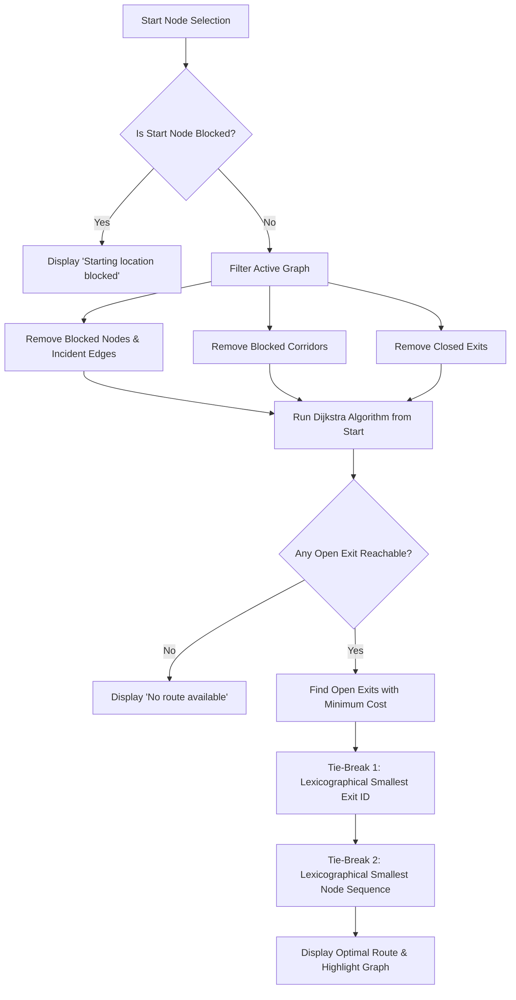

# Smart Escape — Interactive Evacuation Route Simulator

[](https://github.com)
[](LICENSE)
[](index.html)

**Smart Escape** is a high-performance, competition-ready browser-based evacuation route simulator built for the **AI DevFest Smart Escape Competition**. It dynamically calculates the lowest-cost evacuation route to an accessible open exit on any valid floor plan dataset, instantly recalculates optimal routes when hazards or closures occur, strictly enforces deterministic lexicographical tie-breaking, and provides full bilingual English and বাংলা interfaces.

> **Disclaimer:** This application is designed as an educational simulation and graph algorithmic demonstration. It is **NOT** a certified real-world architectural life safety or fire evacuation planning tool.

---

## 🌟 Live Demo & Repository Placeholders

- **Live Deployment Link:** `https://devfest-<registration-number>.web.app` *(or GitHub Pages)*
- **Repository URL:** `https://github.com/<username>/devfest-<registration-number>`

---

## 📖 Problem Overview

During emergency evacuations in complex commercial and residential buildings, real-time pathfinding must dynamically adapt to rapidly evolving hazards (e.g., structural fires, corridor blockages, collapsed junctions, or locked emergency exits). 

**Smart Escape** models the building as a weighted undirected graph $G = (V, E)$, where rooms and junctions act as nodes, corridors act as edges with associated evacuation costs (time/distance), and designated exits serve as safe terminals. When obstacles emerge, the system recalculates the global optimal escape path in real-time.

---

## 🚀 Key Features

### 1. Dynamic Graph Import & Strict Schema Validation
- Import any arbitrary local `building.json` file through a native file picker or preset selector.
- Strict schema validation adhering to all competition rules (node count 2–60, edge count 1–150, positive integer costs, no self-loops, no repeated node pairs, proper initial state references).
- Clear, descriptive error messages for malformed files with zero partial rendering and zero crashes.

### 2. Algorithmic Shortest-Path Evacuation Engine
- Implements Dijkstra's algorithm dynamically on unblocked undirected graph topologies.
- **Never hard-codes any building name, node ID, corridor, or sample route.** Works out of the box with unseen valid datasets.
- Automatically handles disconnected subgraphs safely.

### 3. Mandatory Deterministic Tie-Breaking
- **Equal-Cost Exits:** When multiple reachable open exits have the exact same minimum total cost, the system strictly selects the **lexicographically smallest exit ID** (e.g., `E1` over `E2`).
- **Equal-Cost Paths:** When multiple paths to the chosen exit share the same minimal cost, the system chooses the **lexicographically smallest sequence of node IDs** (e.g., `[S, A, EX]` over `[S, B, EX]`).

### 4. Interactive Real-Time Hazard Management
- **Blocked Rooms / Junctions:** Immediately renders the node and all incident corridors unusable.
- **Blocked Corridors:** Disables only that specific corridor; endpoints remain reachable through alternative routes.
- **Closed Exits:** Disables the exit as both a destination and an intermediate traversal node.
- **Immediate Recalculation:** Route updates instantly on every single hazard toggle.

### 5. Start Location & State Safety
- Interactive selection of unblocked rooms or junctions (exits strictly cannot be selected as starting points).
- Displays clear **"Starting location blocked"** (`শুরুর অবস্থানটি ব্লক করা হয়েছে`) if the active start node becomes compromised.
- Displays **"No route available"** (`কোনো পথ পাওয়া যায়নি`) if all exit paths are obstructed.

### 6. Pristine Initial State Restoration (Reset)
- Preserves a deep clone of the imported JSON's original `initial_state`.
- Resetting restores the exact initial hazard configuration rather than simply wiping all hazards.

### 7. Complete Bilingual Interface (English & বাংলা)
- Instant toggle between English and বাংলা across all headings, buttons, instructions, hazard controls, statuses, and validation alerts.

### 8. Premium Command-Center UI & Canvas Background
- Built with a modern dark cybernetic command dashboard aesthetic.
- Includes a 3D Canvas Dotted Surface wave background with dynamic vertex colors, responsive pan-and-zoom SVG graph map, and animated path particle flows.

### 9. Bonus / Enhanced Features
- **In-Browser Automated Compliance Test Suite:** 1-click execution verifying Tests 1–5 and tie-breaker tests live on screen with green/red badges.
- **Evacuation Step Simulation Walkthrough:** Animated simulation token moving step-by-step along the evacuation path.
- **High-Contrast Accessibility Mode:** Toggleable high-contrast color scheme.
- **High-Resolution PNG Map Export:** Generates an instant downloadable PNG diagram of the building map.
- **Synthesized Web Audio FX:** Non-blocking auditory feedback for route calculation, hazard changes, and alerts.

---

## 🧠 How Routing & Hazard Logic Works



---

## 📋 Input JSON Schema

The simulator accepts JSON files formatted according to the following schema:

```json
{
  "building": "East Annex - Practice Building",
  "nodes": [
    { "id": "R1", "label": "Room 101", "type": "room", "x": 60, "y": 65 },
    { "id": "C1", "label": "Junction A", "type": "junction", "x": 190, "y": 65 },
    { "id": "E1", "label": "North Exit", "type": "exit", "x": 445, "y": 65 }
  ],
  "edges": [
    { "id": "L01", "from": "R1", "to": "C1", "cost": 2 },
    { "id": "L02", "from": "C1", "to": "E1", "cost": 3 }
  ],
  "initial_state": {
    "blocked_nodes": [],
    "blocked_edges": [],
    "closed_exits": []
  }
}
```

---

## 🧪 Verification & Sample Test Scenarios

The simulator includes automated tests verifying all official competition requirements:

| Test Case | Scenario | Actions | Expected Path | Expected Cost / Status |
|---|---|---|---|---|
| **Test 1** | Baseline Route | Start `R1` | `R1 → C1 → C2 → E1` | **Cost: 7** |
| **Test 2** | Dynamic Reroute | Start `R1`, Block `C2` | `R1 → C1 → C3 → C4 → E2` | **Cost: 11** |
| **Test 3** | Exit Isolation | Start `R1`, Close `E1` & `E2` | None | **No route available** |
| **Test 4** | Alternate Start | Start `R2` | `R2 → C3 → C4 → E2` | **Cost: 7** |
| **Test 5** | Blocked Start | Start `R1`, Block `R1` | None | **Starting location blocked** |
| **Test 6** | Exit Tie-Break | Equal cost to `E1` and `E2` | `R0 → J1 → E1` | **E1 selected (E1 < E2)** |
| **Test 7** | Path Tie-Break | Paths `[S,A,EX]` vs `[S,B,EX]` | `S → A → EX` | **Lexicographical sequence order** |

---

## 💻 How to Run Locally

Because the application is built using standard native Web technologies (HTML5, CSS3, ES6 Modules), it runs with zero complex build toolchains.

### Method 1: Local HTTP Server (Recommended)
```bash
# Using Python
python -m http.server 3000

# OR using Node.js npx serve
npx serve . -p 3000

# OR using npm scripts
npm start
```
Then open `http://localhost:3000` in Google Chrome or any modern browser.

### Method 2: Running Automated Algorithmic Unit Tests
```bash
node test_router.mjs
```

---

## 🛠️ Technology Stack

- **Markup & Structure:** Semantic HTML5
- **Visual Design & Styling:** Pure Vanilla CSS3 with CSS Variables, Glassmorphism, and Fluid Grid Layout
- **Logic & Graph Algorithms:** Modular Vanilla JavaScript (ES6 Modules)
- **Visual Rendering:** SVG Vector Map + HTML5 2D/3D Dotted Canvas Surface
- **Audio Engine:** Web Audio API synthesized tones

---

## 🤖 AI Tools & Prompts Used

- **AI Model:** Gemini 3.7 Flash
- **Most Useful AI Prompt:**
  > *"Implement Dijkstra's shortest path algorithm on an unblocked undirected graph with multi-destination exit evaluation and strict two-tier tie-breaking: first by lexicographically smallest exit ID, then by lexicographically smallest node sequence array comparison."*

---

## 📸 Screenshots

### 1. Baseline Optimal Route (`R1 → C1 → C2 → E1`, Cost 7)
*(Interactive SVG Map displaying cyan route glow from Room 101 to North Exit)*

### 2. Dynamic Rerouting when C2 is Blocked (`R1 → C1 → C3 → C4 → E2`, Cost 11)
*(Interactive SVG Map displaying red hazard overlay on Junction B and animated green path redirected to South Exit)*

---

## 📄 License

This project is licensed under the [MIT License](LICENSE).
